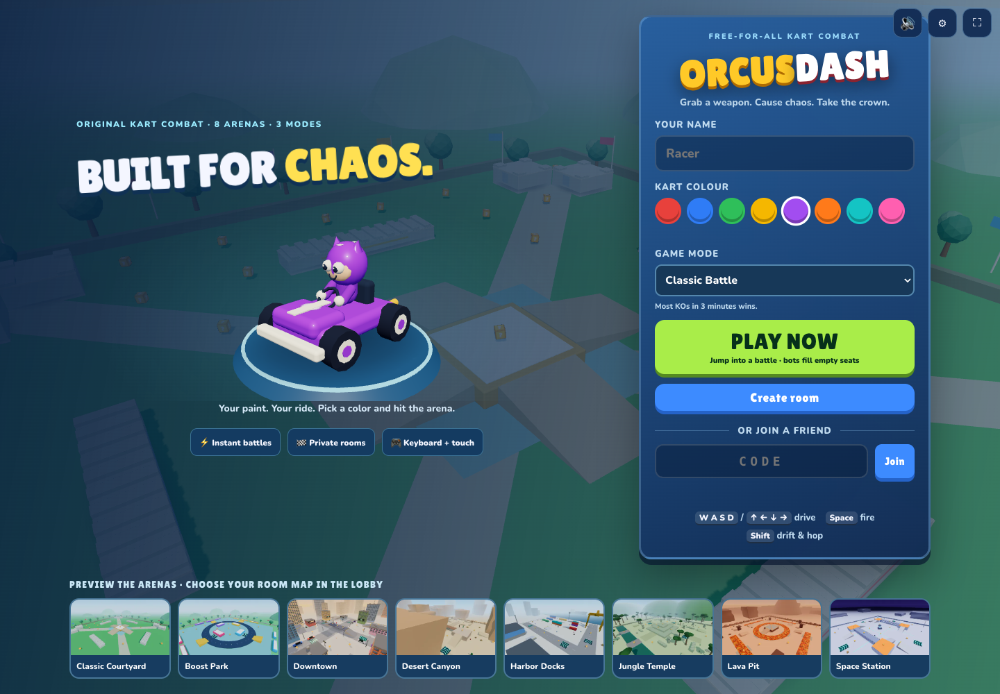
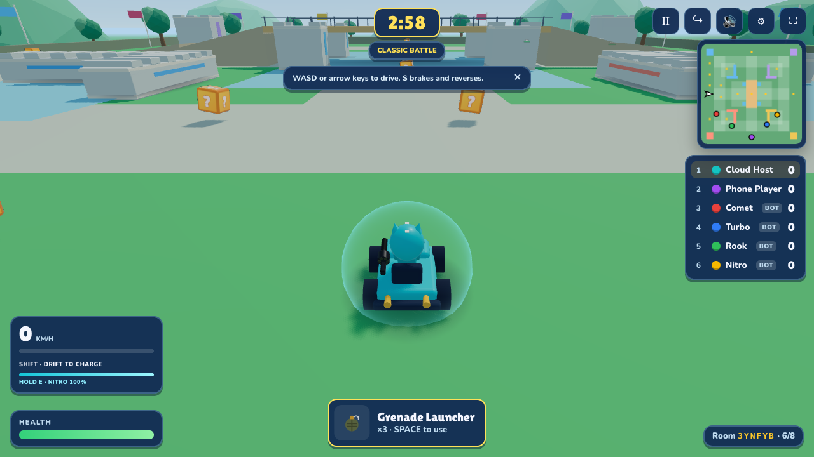
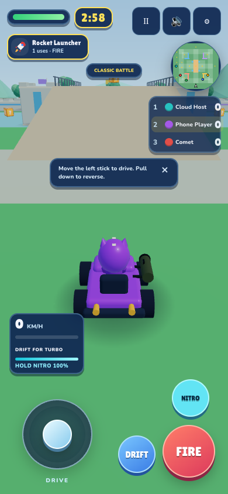

<div align="center">

# OrcusDash

**Grab a weapon. Cause chaos. Take the crown.**

A browser-based 3D kart battle game with online multiplayer, eight arenas, bots, and keyboard + touch controls.

[**Play OrcusDash**](https://orcusdash.orcus-pro01.chatgpt.site) · [Setup](#run-locally) · [Controls](#controls) · [Deployment](#deploy) · [Contributing](CONTRIBUTING.md)



</div>

> **Live demo access:** The hosted game currently has restricted access and may require the owner's ChatGPT account. The source code in this repository is public; you can run your own copy using the instructions below.
>
> **Status:** Advanced playable prototype. Real-device mobile performance, thermal testing, and broader player testing remain release work. See [implementation notes](implementation.md).

## The game

Drive into compact arenas, collect mystery crates, equip kart-mounted weapons, and battle for the most eliminations. Join a public match with **Play Now**, or create a private room and share its six-character code or invite link. Rooms support up to **eight players**; bots fill sparse matches when enabled.

- **Three modes:** Classic Battle (most KOs in three minutes), Kill Race (first to ten KOs, with a time limit), and One-Hit Chaos.
- **Eight arenas:** Classic Courtyard, Boost Park, Downtown, Desert Canyon, Harbor Docks, Jungle Temple, Lava Pit, and Space Station.
- **Six weapons:** twin machine guns, rockets, triple homing missiles, grenades, mines, and shields.
- **Arcade handling:** charged drifting, mini-turbos, rechargeable nitro, ramps, boost pads, and air-time rewards.
- **Phone controls:** persistent joystick, independent fire/drift/nitro buttons, and portrait/landscape layouts.
- **Player comforts:** paint selection, saved preferences, adjustable audio, pause/quit controls, and a 15-second interruption reconnect window.



<details>
<summary>Phone gameplay</summary>



</details>

Screenshots show existing development and hosted builds; they are not performance benchmarks.

## Run locally

Install **Node.js 22** and npm. If you use nvm, `nvm use` selects the included version.

```bash
git clone https://github.com/Orcus01/OrcusDash.git
cd OrcusDash
npm ci
npm run dev
```

Open **http://localhost:5173**. The client runs on port **5173** and the game server on **2567**. No account, database, or API key is needed for local play. A current browser with WebGL support is required.

For multiplayer testing, open a second browser tab or incognito window and join the same room. For a phone on the same Wi-Fi, use the computer's local-network address at port 5173 and allow local firewall access if needed.

## Controls

| Action | Keyboard | Phone |
| --- | --- | --- |
| Drive / brake / reverse | WASD or arrow keys | Joystick |
| Fire | Space | FIRE |
| Drift / mini-turbo | Hold Shift through a turn, then release | DRIFT |
| Nitro | Hold E or L while accelerating | NITRO |
| Pause | Esc or pause button | Pause button |

Online matches continue while your controls are paused. Nitro lasts up to two seconds, refills during active play, and receives rewards from KOs and qualifying jumps.

## Stack and architecture

**TypeScript · Three.js · Rapier · Node.js · WebSockets · Vite · Vitest**

```text
client/       Three.js rendering, Rapier kart physics, touch controls, menus and HUD
server/       Rooms, bots, combat, scoring, movement validation and reconnect sessions
shared/       Protocol, constants, deterministic arena layouts and collision helpers
scripts/      Multiplayer, mobile, collision, reconnect and performance checks
docs/images/  Repository screenshots
deployment/   Existing standalone Railway deployment artifacts
```

The client simulates its own kart for responsive handling and sends movement updates to the server. The server validates movement and owns pickups, damage, projectiles, score, respawns, and match state. Remote karts use interpolation. This is a hybrid design; player physics is not fully server-simulated.

## Checks

```bash
npm run verify
```

This runs TypeScript checks, unit tests, and the production client build. GitHub Actions runs the same verification on pushes and pull requests.

With `npm run dev` running in another terminal:

```bash
npm run e2e                 # Two-player create/join and driving
npm run e2e:mobile          # Emulated touch controls and layout
npm run e2e:network         # Reconnect and session expiry
npm run test:collisions     # Obstacles and ramps across arenas
npm run e2e:fun             # Nitro and driving rewards
```

Browser scripts use an installed Google Chrome. On other systems set `CHROME_PATH` to its executable. Several visual checks currently use macOS Metal launch flags and may need adjustment on other platforms. Mobile emulation does not establish physical-phone performance.

## Deploy

### One Node server

```bash
npm ci
npm run build
npm start
```

The Node server serves `client/dist` and WebSockets together on **port 2567**, or your configured `PORT`. A health endpoint is available at `/health`.

### Docker

```bash
docker build -t orcusdash .
docker run --rm -p 8080:8080 orcusdash
```

Open **http://localhost:8080**. Use a host that supports long-lived WebSocket connections and HTTPS/WSS in production.

### Separate client and server

Set the public game server endpoint at client build time:

```bash
VITE_SERVER_URL=wss://your-game-server.example/ws npm run build
```

Upload `client/dist` to your static host and run the Node game server separately. The environment variable is bundled into the browser client and must contain only a public endpoint. See [HOSTING.md](HOSTING.md) for the existing hosted setup.

**Run one game-server replica.** Rooms and reconnect seats live in memory; restarting the server resets matches. Horizontal scaling, durable sessions, and recovery after server restart are not implemented.

## Development status

The project includes automated multiplayer, touch, collision, reconnect, and resource checks. Earlier validation results and remaining release gates are recorded in [implementation.md](implementation.md); gameplay goals are in [design.md](design.md).

Before treating a build as a broad production release, complete real Android/iPhone playtests, sustained thermal/performance measurements, load testing, and moving-gameplay review across all arenas. The physics bundle is large and download performance needs testing on mobile connections.

## Assets and permissions

Terrain textures are from [Poly Haven](https://polyhaven.com) under **CC0**; see [texture attribution](client/public/tex/LICENSE.md). Dependency licenses remain with their respective authors.

No open-source license has been granted for the project's original code and artwork. Public repository visibility alone does not grant reuse rights.
